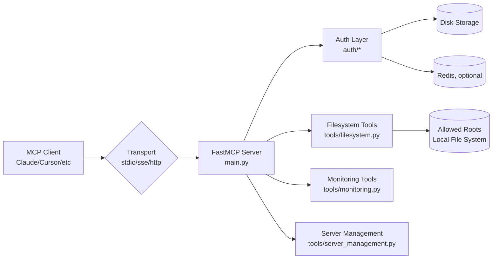

# MCP Filesystem Server

A Model Context Protocol (MCP) server that provides controlled access to the file system, system monitoring tools, and management of allowed root directories.

## Architecture and Components

The project includes:
- **Application server:** Python + FastMCP (`main.py`) with filesystem and monitoring tools.
- **Web/server transport layer:** `stdio`, `sse`, or `http` (configured via `--transport`).
- **File storage:** the local file system (read/write operations within `ALLOWED_ROOTS`).
- **Caching service (optional):** Redis for persistent auth/session storage.
- **Database:** not used in the current architecture (state is kept in Disk/Redis storage).
- **Other components:** auth/access control middleware, logging modules, CI workflow.



## Requirements

- Git
- Python 3.13+
- `pip` or `uv`
- (Optional) Redis 7+ for persistent storage

## Quick Start

```
git clone https://github.com/LyaKonch/filesystem-mcp-server
cd filesystem-mcp-server

uv sync
# make sure the virtual environment is activated

python main.py --allow-cwd --no-auth
```

Without uv:
```bash
git clone <repository-url>
cd filesystem-mcp-server
python3 -m venv .venv
source .venv/bin/activate
python -m pip install --upgrade pip
pip install -e .
cp .env.example .env
# adjust the .env file to your setup
python main.py --allow-cwd --no-auth --transport stdio
```

```powershell
git clone <repository-url>
cd filesystem-mcp-server
py -3.13 -m venv .venv
.\.venv\Scripts\Activate.ps1
python -m pip install --upgrade pip
pip install -e .
Copy-Item .env.example .env
# adjust the .env file to your setup
python .\main.py --allow-cwd --no-auth --transport stdio
```

## Configuration

The main settings can be provided via `.env`:
- `MCP_HOST`, `MCP_PORT`, `TRANSPORT`
- `AUTH_ENABLED`
- `ALLOWED_ROOTS`
- `USE_PERSISTENT_STORAGE`, `USE_REDIS`, `REDIS_HOST`, `REDIS_PORT`
- `LOG_LEVEL`, `LOG_JSON`, `LOG_FILE`, `LOG_MAX_BYTES`, `LOG_BACKUP_COUNT`
- `ERROR_LOCALE` (`uk` or `en`) for localizing user-facing error messages
- `ERROR_REPORTS_FILE` (path to the JSONL file with user error reports)
- `ALERT_WEBHOOK_URL`, `ALERT_WEBHOOK_TIMEOUT_SEC` (webhook for `CRITICAL` error alerts)


Or via CLI flags:
| Argument | Description |
| --- | --- |
| `roots` | Paths to allowed directories (e.g. `python --roots main.py /path/to/dir`). |
| `--allow-cwd` | Allow access to the current working directory. |
| `--no-auth` | Recommended. Disables authentication (useful if you run into token errors). |
| `--transport` | Transport type: `stdio` (default), `http`, or `sse`. |
| `--host`, `--port` | Host and port for HTTP/SSE (default `127.0.0.1:8000`). |
| `--persist` | Persist server state (allowed clients) across restarts. |
| `--debug` | Enable verbose logging for development. |
| `--log-level` | Minimum log level: `DEBUG`, `INFO`, `WARNING`, `ERROR`, `CRITICAL`. |
| `--log-json` | Enable JSON log format (console + file). |

## Logging and Error Handling

- Logging is configured centrally via `logging.config.dictConfig` (`utilities/logging.py`).
- The minimum log level can be changed without rebuilding via `.env` (`LOG_LEVEL`) or the CLI (`--log-level`).
- Logs are written to:
  - `stdout` for `DEBUG/INFO`
  - `stderr` for `WARNING/ERROR/CRITICAL`
  - the `LOG_FILE` file via `RotatingFileHandler`
- Log rotation: `LOG_MAX_BYTES` (max file size) + `LOG_BACKUP_COUNT` (number of backups).
- Logging context is supported: `request_id`, `user_id`, `operation`.
- Global hooks (`sys.excepthook`, `threading.excepthook`) are installed for unhandled exceptions, with an `error_id` (UUID).
- For critical server errors, `main.py` records an `error_id` that can be given to the user for diagnostics.
- Tool call errors go through a single error boundary: the user receives a localized message, an `Error ID`, short recovery steps, and a hint to report the ID to support.
- Optional webhook alerts are supported for `CRITICAL` logs (if `ALERT_WEBHOOK_URL` is set).
- Technical data can be collected from users via the `submit_error_report` tool (summary, error_id, reproduction steps, system info, attachments) and is stored in `ERROR_REPORTS_FILE`.

Recommended mode for local development:
- `--no-auth`
- `--allow-cwd`
- `--transport stdio`

Example command to run as an HTTP server:
```bash
python main.py --transport http --host 127.0.0.1 --port 8000 --persist
```

## Available Tools

Below is the list of tools actually exported by the server code (grouped by functionality). Every tool is protected by access policies — check permissions and restrictions before use.

### File System
- `list_files` — List directory contents (filters, recursion, sizes).
- `get_path_info` — Detailed information and metadata about a file/folder.
- `read_file` — Read a file (option to include image descriptions, size limits).
- `write_file` — Create / overwrite / append to a file.
- `edit_file` — Safely replace a block of text in a file.
- `create_directory` — Create a directory.
- `move_file` — Move / rename a file or folder.
- `search_files` — Search for text in files within a directory.
- `delete_path` — Delete a file or (recursively) a folder.

### Processes
- `run_admin_shell` — (Admin) run a raw shell command.
- `start_process` — Start a process with arguments.
- `get_available_commands` — Return the list of allowed commands.
- `kill_process` — Terminate a process (with confirmation).
- `suspend_process` — Suspend a process.
- `resume_process` — Resume a process.
- `kill_process_tree` — Terminate a process and its descendants.
- `list_processes` — Return short summaries of running processes.
- `get_current_username` — Name of the user the service is running as.
- `get_process_info` — Extended information about a process.
- `get_detailed_process_info` — Deep process diagnostics (tree, connections, open files).
- `get_process_connections` — Network connections of a process.
- `get_process_tree` — Process tree.
- `get_process_open_files` — Files opened by a process.

### Monitoring
- `get_system_resource_usage` — Real-time CPU/RAM usage.
- `get_disk_status` — Disk status and free space.
- `get_system_info` — Static system information and uptime.

### Services (Windows)
- `list_services` — Search/filter services.
- `get_service_status` — Status of a single service.
- `start_service` / `stop_service` / `restart_service` — Service control.
- `stop_service_with_deps` — Stop a service along with its dependencies.
- `change_service_startup_type` / `change_service_config` — Change configuration/startup type.
- `get_service_logs` — Get events from the Application log for a service.
- `create_service` / `delete_service` — Create/delete a service.
- `wrap_script_as_service` — Wrap a script as a Windows service.

### Registry (Windows)
- `list_registry_key` — View a key's subkeys and values.
- `read_registry_key` — Read a specific value.
- `write_registry_key` — Write a value (requires confirmation).
- `delete_registry_key` — Delete a value.
- `get_registry_value_types` — Return the allowed value types.
- `get_registry_hive_path` — Get the hive-namespace mapping.
- `check_key_exists` — Check whether a key exists.

### System / Environment Variables (Windows)
- `get_variable` — Get the value of an environment variable (PROCESS/USER/SYSTEM).
- `list_variables` — List variables for the given scope.
- `set_variable` — Set a variable (PROCESS/USER/SYSTEM).
- `delete_variable` — Delete a variable.
- `create_windows_restore_point` — Create a restore point (requires administrator rights).

### Server Management
- `get_server_status` — MCP server status and client features.
- `list_allowed_roots` — Show allowed root directories.
- `add_allowed_root` / `update_roots` / `remove_root` — Manage the roots whitelist.
- `submit_error_report` — Submit a technical report (with `error_id`).


## MCP Client Configuration (Claude Desktop / Cursor)

### Recommended Configuration (STDIO)

The simplest option, with no port or token issues.

```json
{
  "mcpServers": {
    "filesystem": {
      "command": "python",
      "args": [
        "absolute/path/to/main.py",
        "--allow-cwd",
        "--no-auth"
      ]
    }
  }
}
```

Remember to specify the full path to python (e.g. `.venv/Scripts/python`) if you use a virtual environment.

### HTTP (SSE) Configuration

If you run the server separately (`python main.py --transport http --port 8000 --persist`).

```json
{
  "mcpServers": {
    "filesystem-http": {
      "command": "npx",
      "args": [
        "-y",
        "mcp-remote",
        "http://127.0.0.1:8000/mcp"
      ]
    }
  }
}
```

Note the `/mcp` at the end of the URL.

## Authorization Setup (GitHub OAuth)

To set up the authorization mechanism, see the official guide:
https://gofastmcp.com/integrations/github

It is recommended to create a `.env` file in the server root. `config.py` will load all variables automatically.

Setup notes:
- You need a GitHub OAuth App with a correct callback URL as described in the guide.
- Fill in `FASTMCP_SERVER_AUTH_GITHUB_CLIENT_ID` and `FASTMCP_SERVER_AUTH_GITHUB_CLIENT_SECRET` in `.env`.
- Set `FASTMCP_SERVER_AUTH_GITHUB_BASE_URL` to the server's base URL (for local testing usually `http://127.0.0.1:8000`).
- Persistent authorization requires `JWT_SIGNING_KEY` and `STORAGE_ENCRYPTION_KEY`, and running with `--persist`.
- If you use Redis (unstable, untested), pass the `--redis` flag and set `REDIS_HOST`/`REDIS_PORT`.
- For local development you can (and should) run with `--no-auth` if you run into token errors.

## Troubleshooting

### 🔑 Authentication Issues (Invalid Token / Client Not Registered)

If you see `invalid_token` or `Client Not Registered` errors:

1. Stop the server.
2. Start it with the `--no-auth` flag.
3. Update the client config so it does not expect an auth flow.

Sometimes the mcp-remote tool caches the client-id in its configs, while the server no longer recognizes that user because the authorization tokens in storage were lost or changed. In such cases the only fix is to clear the mcp-remote cache, usually located at `~/.mcp-auth/mcp-remote-<version>`.

For troubleshooting other issues not listed here, see:
`https://docs.scalekit.com/authenticate/mcp/troubleshooting/`  

GitHub authentication is currently under active development. For stable local use it is recommended to disable it.

### 🌐 "Connection Refused" or 404 Error

Make sure you are using the correct port and path. By default the server listens on port 8000 and path `/mcp`.

- Wrong: `http://127.0.0.1/`
- Correct: `http://127.0.0.1:8000/mcp`

### 🔒 Access Denied / Path not allowed

The server only allows access to folders specified at startup or added dynamically.

- Use `list_allowed_roots()` to see which paths are accessible.
- Use `add_allowed_root("/path/to/dir")` to grant access.


### Verifying the Configuration

After setting up mcp.json:

1. **Restart the MCP client** (Claude Desktop, Cursor, etc.)
2. **Check the connection:**
   - Use the `get_client_features()` tool to check capabilities
   - Call `get_allowed_roots()` to check the available directories
3. **Test basic operations:**
   - `list_files(".")` - list files
   - `read_file("README.md")` - read a file

### Debugging the Configuration

#### Problem: The server does not start
**Solution:**
- Check that the paths in `command` and `args` are correct
- Make sure Python and the dependencies are installed
- Check file access permissions

#### Problem: "No allowed roots specified"  
**Solution:**
- Add directories to `args` or use `--allow-cwd`
- Make sure the paths exist and are accessible

#### Problem: "Path is not within allowed roots"
**Solution:**
- Check the list of allowed roots via `get_allowed_roots()`
- Add the required directories to the configuration


## Support

If you have questions or problems:
1. Check the "Troubleshooting" section above
2. Visit the [FastMCP documentation](https://gofastmcp.com) for details
3. Open an issue in the repository

---

**Note:** This server is intended for use in a secure environment. Always check access permissions and restrict access to only the directories you need.

## DevOps and Operations Documentation

- [Production deployment guide](docs/deployment.md)
- [Update and rollback guide](docs/update.md)
- [Backup and restore guide](docs/backup.md)
- [Automation scripts](docs/scripts)

## Extended Technical Documentation

- [Technical design and component interaction](docs/technical_design.md)
- [Linting and static checks](docs/linting.md)
- ["Living" documentation through tests (Test-Driven Documentation)](docs/test_driven_documentation.md)
- [Automatic documentation publishing (CI/CD + GitHub Pages)](docs/docs_publishing.md)
- [Documentation generation guide](docs/generate_docs.md)

## Container and Infrastructure Configs

- `dockerfile`
- `docker-compose.yml`
- `docs/k8s/`
- `docs/terraform/`
- `.github/workflows/quality.yml`

## Project Documentation Policy

- `README.md` covers developer onboarding and the main operational steps.
- `docs/*.md` contain operational instructions for DevOps.
- Changes to configuration or deployment processes must be accompanied by updates to the corresponding files in `docs/`.

### Code Documentation Standard

The project uses **Google Style docstrings** for Python code.

The following must be documented:

- public functions;
- public methods;
- public classes;
- tool factories/registrars (e.g. `register(...)`, `create_...(...)`).

Minimal docstring structure:

```python
"""Short description of the action.

Args:
  arg1: What this parameter is.

Returns:
  Type: What the function returns.
"""
```

Recommendations:

- The first line is a short action in imperative mood (e.g. "Get ...", "Create ...", "Validate ...").
- Async functions use the same format as regular ones.
- If a function can raise important exceptions, add a `Raises` section.
- If an existing docstring is not in Google Style, **update** it rather than duplicating it.

### Contribution Rule

Every PR that changes the public API must also:

1. Update/add Google Style docstrings.
2. Update the description in `README.md`/`docs/*.md` if behavior or API contracts changed.
